

<a href="https://www.linkedin.com/in/joshi-ojas/"></a><a href="https://mail.google.com/mail/?view=cm&fs=1&to=ojas693joshi@gmail.com&su=Hello%20from%20GitHub"></a>

<picture><source media="(prefers-color-scheme: dark)" srcset="assets/readme/showcase-dark.svg"></picture>

<a href="https://prayogshala.app">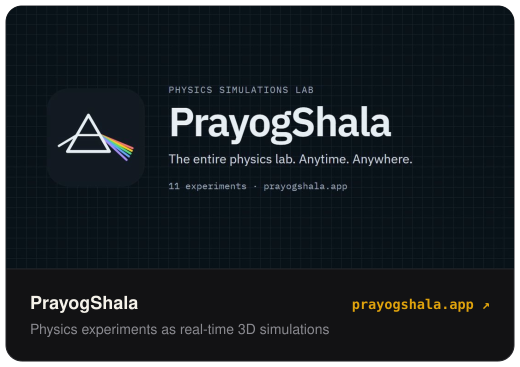</a><a href="https://mail.google.com/mail/?view=cm&fs=1&to=ojas693joshi@gmail.com&su=Hello%20from%20GitHub">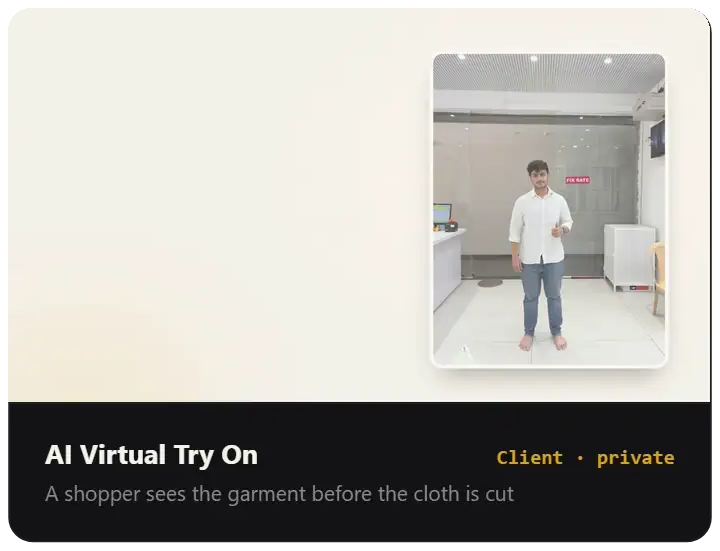</a> 
<a href="https://mail.google.com/mail/?view=cm&fs=1&to=ojas693joshi@gmail.com&su=Hello%20from%20GitHub">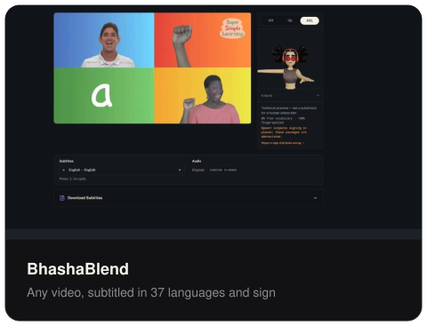</a><a href="https://preeti-joshi-portfolio.ojassuniljoshi.workers.dev/">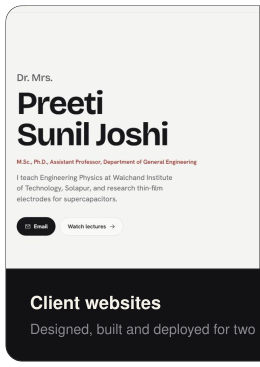</a><a href="https://sanjivkumar-siddul-portfolio.ojassuniljoshi.workers.dev/">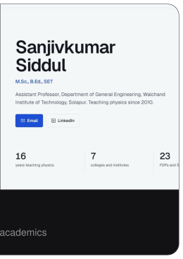</a>

<a href="https://mail.google.com/mail/?view=cm&fs=1&to=ojas693joshi@gmail.com&su=Hello%20from%20GitHub"></a> 
<a href="https://mail.google.com/mail/?view=cm&fs=1&to=ojas693joshi@gmail.com&su=Hello%20from%20GitHub">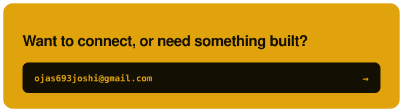</a><a href="https://www.linkedin.com/in/joshi-ojas/">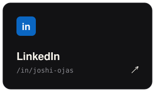</a>

